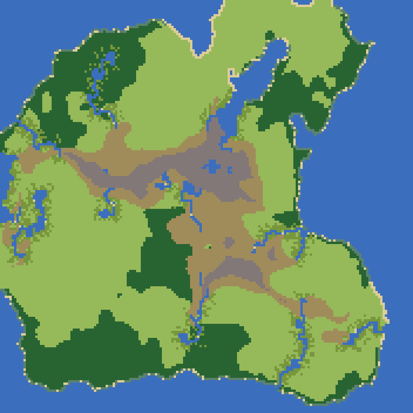
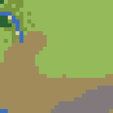
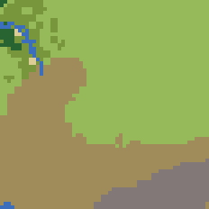

# The large land (step 3)

world4's land (176 x 176 tiles) at twice the scale (352 x 352), by `civ/upsample.py`; drawn by
`python tools/upsample_land.py --state <world4's state dir> --out docs/towns_pics/land`.

| before | after |
|---|---|
|  |  |
|  |  |

The check on world4 (2026-10-17): seen at the old scale the new land is the old on 98.7% of tiles; 23 bodies of water
before and after (no river broken); 504 river tiles, each still a river one tile wide (none filled to a 2 x 2 pool);
regions kept on 99.2% of tiles; 2,514 deposits and 116 named places, each on dry land in its old tile's block. SOUND.

Borders wander through a smooth warp (up to about one old tile), so coasts, forest edges and hills gain shape at the
finer scale; sea and lakes double; rivers run as one-tile chains through the points of their old tiles.
