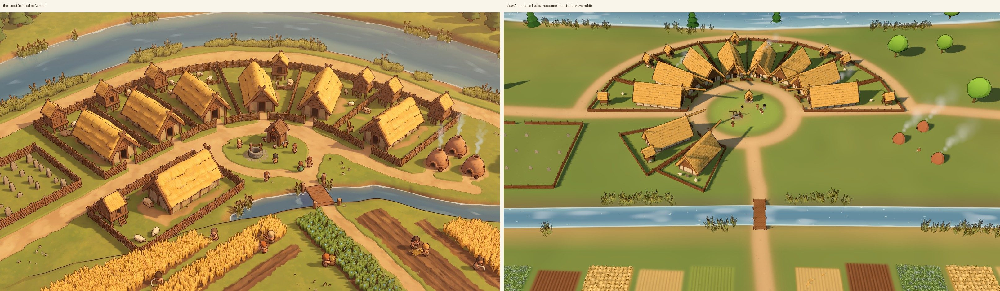

# world5 step 0: the look, proven (results, 2026-10-17)

The spec is [world5_handoff.md](../world5_handoff.md) §5. What was built, what it looks like beside the target, what it
costs, and what step 5 must add. Nothing in the engine changed.

## What was built

- **The page:** `civ/viewer/demo.html` (not linked from the viewer, like `gallery.html`; no build step, vendored three.js
  r186). `?tour=1` the fly-down (41 s), `?walk=1` the walk, `?shot=A..F` the set views, `?debug=1` frames a second,
  draw calls and triangles, `?tier=phone` the light tier (chosen by itself on a narrow screen), `?models=cc0` the
  ready-made models. Free orbit: drag to pan, right-drag (or shift, or two fingers) to turn and tilt, wheel or pinch
  to zoom.
- **The data:** `civ/viewer/demo/river_village.json`, written by `tools/demo_village.py` in towns_spec §3's shapes, in
  metres (x east, y south): the land (coarse heights every 250 m, the river and stream as curves with widths, four
  forests as polygons, clearings), lanes, plots with gates, 46 buildings with positions, angles and sizes, 26 field
  strips with their crops, 29 people with their tasks and paths, sheep, trees about the village. 27 KB. The generator
  is the settlement planner's first fixture.
- **`landAt`** (`demo/land.js`): height (Catmull-Rom through the coarse grid, so no creases, plus three octaves of
  value noise, gentler in the village), water (distance to the river and stream curves against their widths, beds
  and banks shaped from it; the stream's level falls to the river's at its mouth), wetness (the reed margins), tree
  cover (forest polygons feathered by noise over about 150 m; clearings; none on banks or in the village) and the
  ground's colour as a smooth blend. Pure, runs in Node; the integer hash and noise are written to port exactly.
  Tested (`demo/test/land.test.js`, run by `tests/test_world5_demo.py`).
- **One seamless land** (`demo/terrain.js`): a quadtree of patches (a leaf 125 m, 40 x 40 cells: 3.1 m; the root 16 km),
  split by distance; each vertex carries the height the next coarser patch would give it and slides there before its
  patch changes level (geomorphing, CDLOD), so a change of detail moves nothing on screen; skirts close cracks between
  neighbours. The ground's colour is **not in the mesh**: it is read in the shader from maps laid over the world by
  position (the land's blend over 8.4 x 5.2 km at 6.6 m a pixel, a coarse one to 16 km, and the village's ground
  painted at 0.22 m a pixel: lanes with soft worn edges, the green, yards, strips with furrows, the burial ground).
  So colour is identical at every level of detail and **no tile or chunk edge can show** anywhere, from 4 km up to
  the ground. Close up the shader adds mottling and grain, fading with distance.
- **Water and ways** (`demo/water.js`): the river (46 m) and stream (7 m) as ribbons along their curves (toon water,
  streaks drifting with the flow, a light line at the banks, sun glints), the 4 km track as a soft-edged earth ribbon.
  Ribbons are pulled toward the camera in depth only, and patches too coarse to hold a channel lower their ground
  under it, so the coarse land far off never covers a river.
- **The art kit** (`art/village.js`, shared with the viewer, data-driven by kind): long house (plastered walls in a
  timber frame on a plinth, a deep thatch extruded with a swelling, a rounded ridge and soft edges, thatch courses and
  dark cut strokes drawn in the shader from the object's own coordinates, boarded gables, crossed finials, the door
  in the gable), store on stilts with its ladder, well, shrine with a lantern and offerings, beehive kiln, grave stone,
  plank bridge, conical hut, fire, drying rack, wattle fence panels (woven in the shader) and posts, wheat and flax
  tufts, reeds with cattails, broadleaf and conifer trees. Snow lies on whatever faces up when it is winter.
- **Placing it** (`demo/town.js`, `demo/flora.js`, `demo/folk.js`): every building and fence instanced by kind; crops
  in three levels (real tufts within 50 m, then the strip as 11 stacked shells cut into tufts and stalks, then the
  painted strip, each dithered into the next); reed beds along the banks in 200 m blocks drawn within 460 m; 113,000
  trees placed by tree cover (whole trees near, a lit disc or spire far, dithered into one another at 300-380 m; far
  off the crowns grow into a closed canopy); people are the viewer's own chibi figures and motions, in metres, with
  three levels of detail; people stand on the bridge's deck.
- **The look:** the toon ramp, a warm low sun from the west-south-west and a cool sky, one shadow map that follows
  the view, haze that closes with height, a sky dome, smoke from the kilns, the hamlet's fire and some hearths, and a
  finishing pass that draws a gentle dark outline wherever depth jumps (roofs, fences, people, trees) and grades the
  colour.
- **The tour and the walk:** one Catmull-Rom path through key views (distance in logs), built ahead so no patch is
  built in flight; the walk follows one person from their door across the green and the bridge, through the strips
  and onto the track to the hamlet, the camera 6.5 m behind at shoulder height (time runs five times fast).
- **Tools:** `tools/demo_shots.mjs` (the views at 1600 x 900 and Pixel 9 size, the fly-down and walk as mp4, the
  numbers), `tools/demo_compare.py` (the side-by-side).

## A beside the target

The other views: [B, 600 m up](step0/B.jpg), [C, 4 km up](step0/C.jpg), [D, 15 m over the well](step0/D.jpg),
[E, the walk at the bridge](step0/E.jpg), [F, a winter night](step0/F.jpg), [all six at phone size](step0/phones.jpg).

**What matches:** the form (long houses gable-end to the curving lane round the green, fenced plots fanning back to
the river, a store on posts in most yards, sheep, the green with its well and shrine, smoking kilns east, the burial
ground west, the stream with its plank bridge, strips of wheat, flax, fallow and stubble beyond, people at their
work); thick golden thatch with ridge and crossed finials; wattle fences; reeds; soft shadows from a low sun; a gentle
outline. And what the target cannot show: it is one place in one continuous land. From the well (D) up to 4 km (C),
where the village is a speck by the river and the forest and the hamlet's clearing lie beyond the track, the camera
never cuts and the ground never shows a seam.

**What falls short, and why:**
- **Scale and framing.** The painting compresses the village (the river right behind the houses, the strips right
  below the green) and is seen closer and lower. The demo keeps true metres (a 15 m house, a 46 m river), so at the
  same framing the houses are smaller in the picture. Closer views (D, and the fly-down passing 60-150 m) show the
  buildings as large as the target does. This is a choice: world5 is a large real world.
- **Surface richness.** The target is painted: every thatch roof has hand-drawn strokes and light, the lanes have
  edges and stones, grass has tufts everywhere. The demo's thatch, wattle and planks are procedural patterns that read
  at 50-150 m but are plainer than paint; the ground away from lanes is smooth colour with mottling. Step 5 needs grass
  tufts near the camera, pebbles and wear on lanes, a richer thatch shader (lighter tips, deeper overlaps) and a little
  ambient occlusion where things meet the ground.
- **Light and colour.** The target has a strong golden grade with deep warm shade; the demo's light is softer and its
  greens cooler. A colour grade (a lookup table) and warmer shade would close most of this cheaply.
- **Crops.** Wheat as shells reads as golden tufts from above; at a low angle from far off it flattens. Close by, real
  tufts take over. Good enough to judge; the stalks could be taller and the ears chunkier, as the target's are.
- **People.** Correct and charming close up (D, E), but small at A's distance; the target draws them larger than
  life. The figures could be drawn larger with distance (as maps do) if wanted.

## Numbers

Draw calls and triangles per frame, everything counted (the scene, its shadow pass and the finishing pass), from
`?debug=1` / `renderer.info`:

| View | Desktop draws | Desktop triangles | Phone tier draws | Phone tier triangles |
|---|---|---|---|---|
| A target view | 182 | 0.35 M | 158 | 0.25 M |
| B 600 m up | 167 | 0.24 M | 152 | 0.19 M |
| C 4 km up | 271 | 0.33 M | 123 | 0.16 M |
| D 15 m over the well | 149 | 0.32 M | 133 | 0.28 M |
| E the walk at the bridge | 145 | 0.62 M | 111 | 0.49 M |
| F as A, winter night | 180 | 0.34 M | 156 | 0.25 M |

viewer.md §9's phone budget is about 0.55 M triangles in the main pass and 0.95 M with shadows: **every view is under
it**, and B and D (the acceptance views) are at about half. The scene holds 113,107 trees, 14,370 crop tufts, 8,883
reed clumps, 447 fence panels. Draw calls (110-270) are within what a Pixel 9 handles; C's are mostly tree blocks
and can be halved by merging the far blocks.

**Frames a second could not be measured here:** the container has no GPU, and Chromium renders with software WebGL
(SwiftShader), 1.3-3.9 s a frame on the CPU, which says nothing about a phone. The real number takes one minute on
the Pixel 9: open the page with `?debug=1` (and `&tour=1`) and read the top line. If it is under 30, the levers in
order of cost: the pixel ratio (1.75 on the phone tier now), the crop shells (11 layers), the shadow map size, the
tree near band.

## Models: code-made, CC0, or a mix (recommendation)

Both were tried. The CC0 route: the Kenney Nature Kit (CC0, the licence in `vendor/models/kenney-nature/`), 14
models vendored (192 KB), loaded with three's glTF loader (vendored, MIT), merged into one geometry each with their
colours baked, scaled to metres and drawn with the same toon materials (`?models=cc0` swaps the trees and adds bushes,
rocks, stumps and log stacks). Seen side by side ([the kit's trees left, Kenney's right](step0/models_code_vs_cc0.jpg)), Kenney's trees are flat-faceted and saturated, a different style
from the soft rounded kit, and nothing ready-made exists for the things that define the look (a thatched long house of
these proportions, a store on stilts, a beehive kiln, wattle fences, a conical hut): those would be made in code anyway,
and they are the most visible things in a settlement.

**Recommendation: code-made, with CC0 only for small scatter** (rocks, stumps, log piles, mushrooms), restyled with
the toon materials, where a ready-made shape saves time and style matters less. Code-made models share one palette,
one light and one set of patterns, take their sizes from the data (a long house of any length, a plot's fence of any
shape), and cost nothing to download.

## What step 5 must add

- Feed the scene from world data (format 4, towns_spec §9.1) instead of the hand-made file; stream the colour maps by
  region (the village map becomes one per settlement, painted from its plan).
- The five peoples' looks (only the river folk's long house and the forest folk's hut exist).
- Middle distance for buildings: merged simplified roofs per settlement beyond about 600 m (not needed for one
  village; needed for sixty).
- Paths for people (towns_spec §9.4); here they walk straight lines between points.
- The ground's close-up richness, the colour grade, and larger people at a distance (above).
- Day and season driven by the world's clock (the demo has one afternoon and one winter night).
- A real measure on the Pixel 9.
